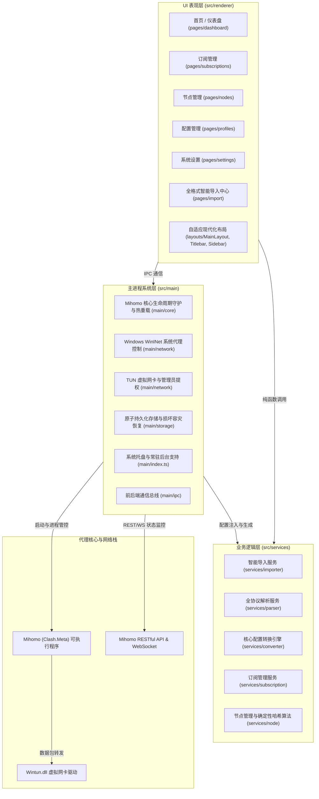

# NexLink 系统架构设计文档 (Architecture)

## 一、系统总体定位与架构目标

NexLink 是基于现代桌面技术栈构建的新一代 Windows 代理客户端，定位为：
**融合 Clash Verge Rev 的高颜值现代 UI + v2rayN 极致自由的全格式订阅导入体验。**

本系统严格遵守**高内聚、低耦合、模块化、单向依赖**的架构设计原则，确保 UI 展示层、核心业务逻辑、底层代理核心以及操作系统网络控制层彻底解耦。

---

## 二、系统架构总览 (Layered Architecture)

---

## 三、核心技术模块设计

### 1. 全格式智能导入流水线 (Smart Importer Pipeline)
* **协议覆盖**：VMess、VLESS (含 XTLS-Reality / Vision / gRPC)、Shadowsocks (含 SIP002 与 2022 规范)、Trojan、Hysteria 2、TUIC v5、WireGuard、Clash YAML、sing-box JSON 与 v2rayN 订阅密文。
* **确定性 ID 引擎**：节点 ID 基于协议核心参数计算哈希，避免每次刷新重新生成随机 ID 导致用户选中的出站节点失效。
* **纯本地无损解析**：全部在本地运行时完成，绝不请求任何第三方远程转换服务器。

### 2. 零断网平滑热重载 (Hot Reload)
* 当订阅更新、节点变动时，优先调用 Mihomo 官方 RESTful API `PUT /configs?force=true`，实现无感热加载。
* 保持现有活跃 TCP 连接与 UDP 会话不中断，杜绝频繁断网重连。

### 3. 系统代理与崩溃安全防护
* 真实捕获 Windows 注册表原生代理设置并进行磁盘持久化备份。
* 退出或异常崩溃时，通过原生 `reg.exe` 同步指令和 WinINet 广播毫秒级恢复直连，防范死代理滞留导致浏览器断网。
